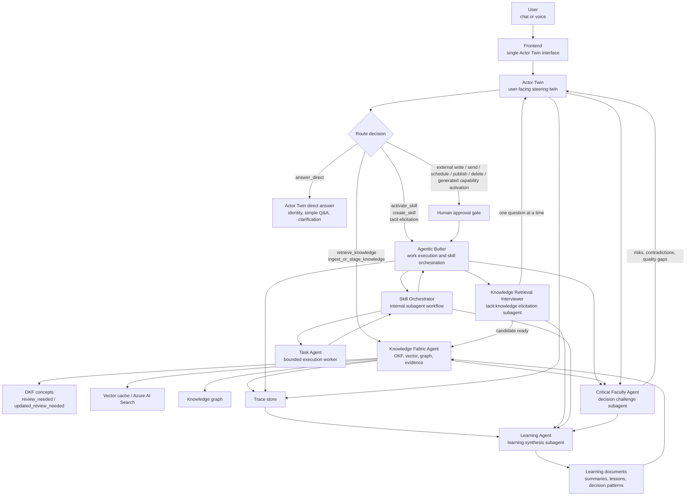
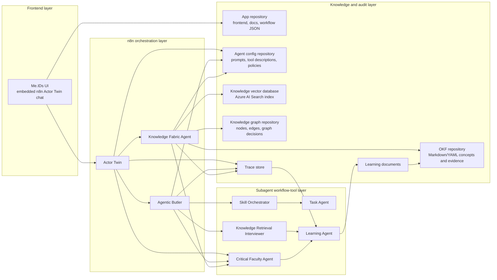
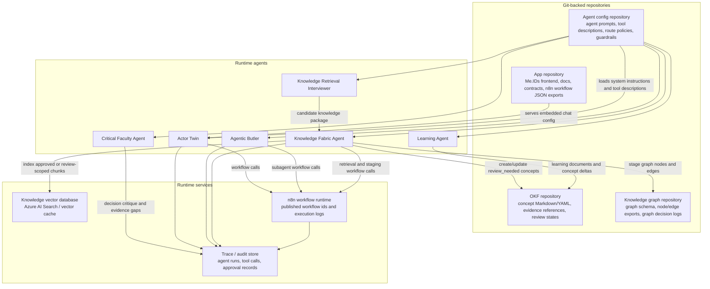
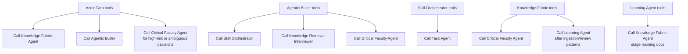

# Me.IDs Agent Routing Overview

## Current And Target Routing



## Layer Model



## Storage Topology



## Storage Responsibilities

| Storage target | Current role | Written by | Read by | Review boundary |
|---|---|---|---|---|
| App repository | Frontend, static assets, docs, contracts, n8n JSON exports, UAT scripts | Developers / deployment pipeline | Frontend, CI, operators | Code review before deployment |
| OKF repository | Canonical concept and evidence files in Markdown/YAML | Knowledge Fabric Agent, Learning Agent through Knowledge Fabric | Actor Twin, Knowledge Fabric, vector indexing jobs | New/changed concepts stay `review_needed` or `updated_review_needed` |
| Knowledge graph repository | Graph schema, candidate/promoted nodes and edges, graph decision records | Knowledge Fabric Agent, Graph Curator, Critical Faculty recommendations | Actor Twin, Knowledge Fabric, Critical Faculty | Candidate edges need review before trusted graph use |
| Agent config repository | System prompts, tool descriptions, routing rules, guardrails, approval policies | Developers / approved config automation | n8n agents and workflow import scripts | Prompt/tool changes require review before production activation |
| Knowledge vector database | Searchable embeddings and retrieval chunks, typically Azure AI Search | Indexing jobs from OKF and evidence sources | Actor Twin and Knowledge Fabric Agent | Trusted index should prefer approved concepts; UAT may include review-scoped indexes |
| Trace / audit store | n8n executions, tool calls, handoffs, approval records, UAT evidence | n8n workflows and backend adapters | Review cockpit, Learning Agent, Critical Faculty | Trace is evidence, not automatically approved knowledge |

## Routing Responsibilities

| Agent / Subagent | Layer | Called by | Purpose | Human approval |
|---|---|---|---|---|
| Actor Twin | Frontend-facing n8n agent | Frontend embedded chat | Interpret intent, answer directly, route to tools | Only for explicit risky boundary |
| Knowledge Fabric Agent | n8n workflow tool | Actor Twin, Learning Agent | Retrieve, stage, update OKF concepts, evidence, vector and graph context | No approval for `review_needed` or `updated_review_needed` staging |
| Agentic Butler | n8n workflow tool | Actor Twin | Draft, plan, run approved skills, orchestrate subagents, propose new skills/agents | Approval only before generated capability activation or external side effects |
| Skill Orchestrator | Butler subagent workflow | Agentic Butler | Decompose an approved skill run into bounded steps | No approval unless the step has external side effects |
| Task Agent | Butler subagent workflow | Skill Orchestrator | Execute one bounded task with clear input/output | No approval for no-write internal work |
| Knowledge Retrieval Interviewer | Butler subagent workflow | Agentic Butler | Elicit tacit knowledge via circular and deep-dive questions | No approval; output goes to review-needed knowledge |
| Critical Faculty Agent | subagent workflow | Actor Twin, Butler, Knowledge Fabric | Challenge assumptions, detect contradictions, assess risk and decision quality | No approval; it can recommend an approval gate |
| Learning Agent | subagent workflow | Trace jobs, Butler, Knowledge Fabric | Summarize lessons, UAT findings, and repeated patterns into learning documents | No approval for drafts; Knowledge Fabric stages outputs for review |

## Recommended Tool Placement



## Routing Rules

- Actor Twin remains the only user-facing routing authority.
- Knowledge Fabric Agent handles direct retrieval, evidence, OKF staging, vector context, and graph context.
- Agentic Butler handles work artifacts, approved skill execution, skill/agent proposals, and tacit knowledge elicitation.
- Knowledge Retrieval Interviewer is not a top-level frontend agent; it is called through Agentic Butler.
- Skill Orchestrator and Task Agent stay internal to Agentic Butler.
- Critical Faculty Agent should be callable wherever a route, decision, evidence claim, or proposed action may be wrong, risky, contradictory, or under-evidenced.
- Learning Agent should run after traces, UAT results, interviews, skill runs, and review outcomes create reusable lessons.
- Learning Agent outputs learning documents, not approved truth. Knowledge Fabric stages them as `review_needed` or `updated_review_needed`.
- Human approval is required before generated skills/agents become active and before real external side effects.

## Tool Descriptions For n8n

### Actor Twin / Butler / Knowledge Fabric Tool: Critical Faculty Agent

Use this description on every `Call n8n Workflow Tool` node that calls Critical
Faculty Agent:

```text
Call this internal workflow tool when a route decision, answer, knowledge claim, skill proposal, task-agent result, graph implication, vector-readiness decision, or proposed action needs independent decision-quality critique.

Use it for ambiguity, weak evidence, contradictions, stale or draft knowledge, hidden assumptions, approval-boundary uncertainty, high-impact recommendations, generated capability proposals, or premortem-style risk review.

Do not call it for ordinary chat, simple drafting, low-risk formatting, or identity/status questions. Critical Faculty cannot approve, execute, persist, send, schedule, publish, delete, commit, or activate anything. It returns critique, recommendation, Knowledge Fabric action advice, and caller next step.
```

### Actor Twin / Knowledge Fabric Tool: Learning Agent

Use this description on every `Call n8n Workflow Tool` node that calls Learning
Agent:

```text
Call this internal workflow tool after completed traces, interviews, UAT results, source ingestion, skill runs, critical-faculty critiques, review decisions, or repeated failures when the interaction produced reusable lessons.

The Learning Agent creates reviewable learning documents, concept deltas, decision-pattern summaries, failure-mode notes, and future-behavior-change candidates. Its outputs must be staged through Knowledge Fabric as review_needed or updated_review_needed, not treated as approved truth.

Do not call it for real-time user answering, fresh tacit-knowledge interviews, direct OKF/vector/graph retrieval, skill execution, approvals, or external side effects.
```

### Agentic Butler Tool: Skill Orchestrator

Use this description on the Agentic Butler `Call n8n Workflow Tool` node:

```text
Call this tool when Agentic Butler needs to execute an approved skill, coordinate a multi-step no-write work artifact, decompose an approved generated capability into execution steps, or delegate bounded work to task agents.

The Skill Orchestrator turns one approved skill objective into a concise execution plan, calls the minimum necessary Task Agent steps, validates their outputs, and returns one coherent result to Agentic Butler with assumptions, task trace, risks, and approval boundaries.

Do not call this tool for simple one-step drafting that Agentic Butler can complete directly. Do not call it for tacit knowledge interviews; use Knowledge Retrieval Interviewer for that. Do not use it for direct OKF/vector/graph retrieval; use Knowledge Fabric Agent. Human approval is required only before external side effects or activation of newly generated capabilities.
```

### Skill Orchestrator Tool: Task Agent

Use this description on the Skill Orchestrator `Call n8n Workflow Tool` node:

```text
Call this tool for exactly one bounded execution step from a Skill Orchestrator plan, such as extracting facts, drafting one section, comparing options, formatting content, validating completeness, or summarizing provided material.

Provide the task objective, relevant context, expected output format, constraints, non-goals, and approval boundary. The Task Agent must not redefine the skill objective, choose tools outside scope, approve anything, persist knowledge directly, or perform external write/send/schedule/publish/delete/commit actions without explicit approval in the task input.

Use the fewest Task Agent calls necessary and validate every result before synthesis.
```

## Zielmodus: Skill Orchestrator And Task Agent Integration

1. Write source-controlled system instructions for Skill Orchestrator and Task Agent.
2. Patch the live Skill Orchestrator AI Agent system message from `prompts/skill-orchestrator/system.md`.
3. Patch the live Task Agent AI Agent system message from `prompts/task-agent/system.md`.
4. Ensure Skill Orchestrator has a `Call n8n Workflow Tool` connection to Task Agent.
5. Add Skill Orchestrator as a `Call n8n Workflow Tool` on Agentic Butler.
6. Update Agentic Butler system message so normal multi-step skill execution routes through Skill Orchestrator, while tacit knowledge routes through Knowledge Retrieval Interviewer.
7. Run UAT:
   - Butler normal one-step draft can complete without approval.
   - Butler multi-step approved skill execution calls Skill Orchestrator.
   - Skill Orchestrator can call Task Agent.
   - No-write work remains approval-free.
   - External side effects and generated capability activation still stop at approval.

## Zielmodus: Critical Faculty And Learning Agent Integration

1. Create source-controlled system instructions:
   - `prompts/critical-faculty/system.md`
   - `prompts/learning-agent/system.md`
2. Create or update live n8n callable workflows:
   - `Me.IDs Critical Faculty Agent - staging`
   - `Me.IDs Learning Agent - staging`
3. Attach Critical Faculty Agent as `Call n8n Workflow Tool` to:
   - Actor Twin
   - Agentic Butler
   - Knowledge Fabric Agent
4. Attach Learning Agent as `Call n8n Workflow Tool` to:
   - Actor Twin
   - Knowledge Fabric Agent
5. Attach Knowledge Fabric Agent as `Call n8n Workflow Tool` inside Learning
   Agent so learning documents and concept deltas can be staged as
   `review_needed` or `updated_review_needed`.
6. Patch live system messages:
   - Actor Twin remains the only user-facing chat and calls Critical Faculty or
     Learning only when routing criteria apply.
   - Agentic Butler calls Critical Faculty before generated capability proposals,
     risky skill plans, conflicting task-agent outputs, or approval-boundary
     decisions.
   - Knowledge Fabric calls Critical Faculty for evidence/graph/vector/review
     challenge and stages Learning Agent output through review states.
7. Run focused UAT:
   - Critical Faculty can critique a risky decision without approving or
     executing anything.
   - Learning Agent can summarize a failed UAT trace into a review-needed
     learning document candidate.
   - Actor Twin has both tools attached.
   - Agentic Butler and Knowledge Fabric have Critical Faculty attached.
   - Learning Agent has Knowledge Fabric attached.
