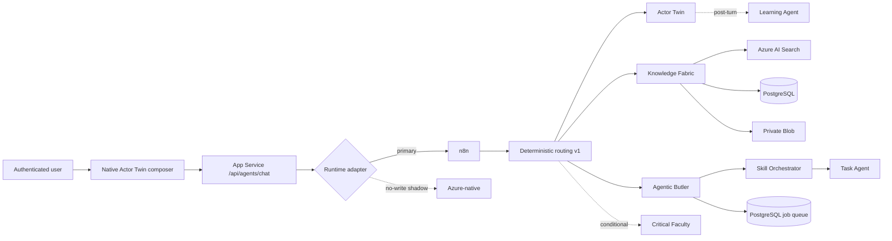
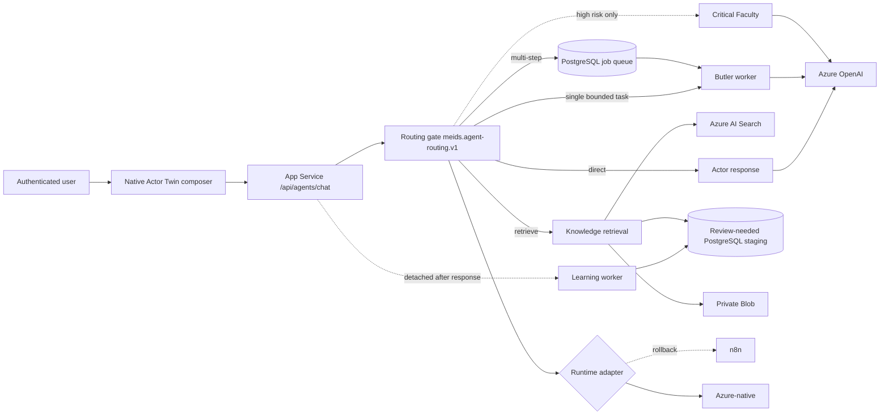

# Me.IDs Azure-native agent target

Last updated: 2026-11-12

## Current production interaction

## Target interaction and adapter boundary

## Decisions

1. `meids.agent-routing.v1`, `meids.agent-work.v1` and `meids.agent-slo.v1` remain provider-neutral contracts. Moving a worker from n8n to Azure must not change them.
2. Actor Twin answers directly when no stored fact, evidence, work artifact or side effect is requested.
3. Personal, organizational, evidence and prior-decision questions retrieve approved knowledge before generation. Missing evidence returns `not_found` plus one targeted question.
4. One bounded, no-side-effect task bypasses Skill Orchestrator. Multi-step work is acknowledged and queued before generative work begins.
5. Critical Faculty runs only for high-risk or uncertain evidence-dependent decisions.
6. Learning is detached from the user response and may create only review-needed proposals.
7. Unknown completion is never retried automatically. Cancellation is allowed only before a worker lease is acquired.
8. The browser receives no n8n worker URL in native mode. Authentication, retrieval, progress, cancellation and result reads go through App Service routes.

## Azure production resources

| Capability | Resource / contract | State |
| --- | --- | --- |
| Runtime API | `meids-prod-backend-1853a19b` | Existing |
| Durable queue | PostgreSQL `runtime.background_job`, migration 020 | Applied |
| Model | `aoai-meids-prod-1853a19b` / `meids-gpt-4-1-mini` | Provisioned, managed-identity RBAC |
| Retrieval | `srch-meids-prod-1853a19b` | Existing |
| Artifacts | `stmeidsprod1853a19b` private Blob | Existing |
| Browser composer | `MEIDS_NATIVE_ACTOR_CHAT=true` | Production; no n8n URL exposed |
| Rollback | `MEIDS_AGENT_RUNTIME=n8n` | Active during shadow soak |

## Current rollout state

- PR #53 and merge commit `386ee6c1141212bbdd9c7d5b1a56fba216e19205` are deployed to backend and frontend.
- The browser talks only to authenticated App Service routes; direct n8n URLs are empty in production runtime configuration.
- n8n remains the authoritative provider while Azure-native no-write shadow results are compared.
- An authenticated production browser session and correlated web-process trace are still required before enabling the first Azure route canary.

## Cutover gates

- Shadow comparisons show no tenant, user, twin, evidence or approval drift.
- Direct and retrieval p90 remain within 20/30 seconds; async acknowledgement remains below 10 seconds.
- Native chat passes expired-auth no-replay, queued-only cancellation, keyboard and responsive-browser tests.
- Azure OpenAI access is private-network restricted after App Service connectivity is proven.
- Route canaries progress in this order: direct, retrieval, synchronous work, background work, detached Learning.
- n8n credentials and workflows remain available for the rollback window and are removed only after audit retention expires.
