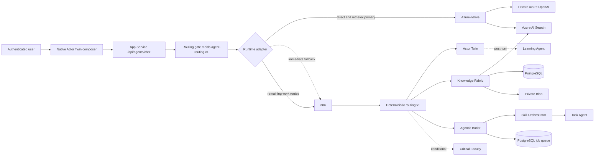
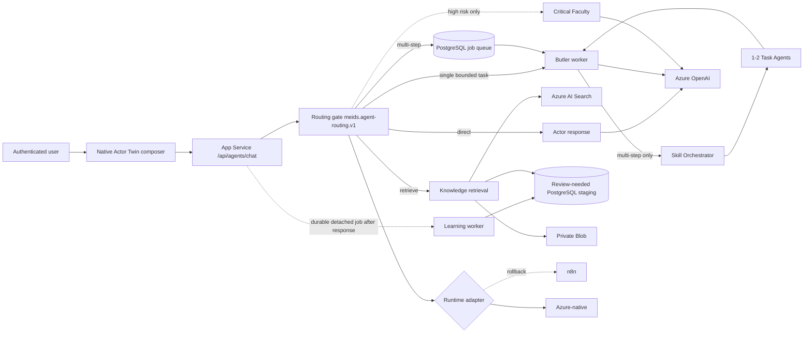

# Me.IDs Azure-native agent target

Last updated: 2026-11-12

## Current production interaction

## Target interaction and adapter boundary

## Decisions

1. `meids.agent-routing.v1`, `meids.agent-work.v1` and `meids.agent-slo.v1` remain provider-neutral contracts. Moving a worker from n8n to Azure must not change them.
2. Actor Twin answers directly when no stored fact, evidence, work artifact or side effect is requested.
3. Personal, organizational, evidence and prior-decision questions retrieve approved knowledge before generation. Missing evidence returns `not_found` plus one targeted question.
4. One bounded, no-side-effect task bypasses Skill Orchestrator. Multi-step work is acknowledged and queued before generative work begins.
5. Critical Faculty runs only for high-risk or uncertain evidence-dependent decisions.
6. Learning is detached from the user response and may create only review-needed proposals.
7. Unknown completion is never retried automatically. Cancellation is allowed only before a worker lease is acquired.
8. The browser receives no n8n worker URL in native mode. Authentication, retrieval, progress, cancellation and result reads go through App Service routes.

## Azure production resources

| Capability | Resource / contract | State |
| --- | --- | --- |
| Runtime API | `meids-prod-backend-1853a19b` | Existing |
| Durable queue | PostgreSQL `runtime.background_job`, migration 020 | Applied |
| Model | `aoai-meids-prod-1853a19b` / `meids-gpt-4-1-mini` | Provisioned, managed-identity RBAC |
| Retrieval | `srch-meids-prod-1853a19b` | Existing |
| Artifacts | `stmeidsprod1853a19b` private Blob | Existing |
| Browser composer | `MEIDS_NATIVE_ACTOR_CHAT=true` | Production; no n8n URL exposed |
| Runtime canary | `MEIDS_AGENT_RUNTIME=hybrid` | `answer_direct,retrieve_knowledge` Azure-native; n8n fallback retained |
| Model network | private endpoint and private DNS | Public Azure OpenAI access disabled after live App Service proof |
| Rollback | `MEIDS_AGENT_AZURE_FALLBACK_TO_N8N=true` | Route-level immediate fallback during soak |

## Current rollout state

- PR #55 and merge commit `b487f2f1b4704796ad773b6d51cbb16847e339c7` are deployed to the backend; the native frontend remains active.
- The browser talks only to authenticated App Service routes; direct n8n URLs are empty in production runtime configuration.
- Direct-answer shadow and primary canaries passed from the real App Service web process. A 20-request soak returned 20/20 expected answers with p50 814 ms, p90 1,044 ms and max 1,402 ms.
- Missing and forged knowledge tokens both return `401 blocked_auth_context`.
- Retrieval shadow and primary canaries passed. No matching approved evidence returns `not_found` and one targeted question without speculation.
- App Service managed identity continued to answer after Azure OpenAI public access was disabled, proving the private model path.
- The next code candidate moves synchronous Butler work, background Skill/Task execution and detached Learning behind the same adapter and PostgreSQL queue. It remains unpromoted until protected CI and production canaries pass.

## Cutover gates

- Shadow comparisons show no tenant, user, twin, evidence or approval drift.
- Direct and retrieval p90 remain within 20/30 seconds; async acknowledgement remains below 10 seconds. Direct is currently 1.044 seconds p90 across 20 serial requests.
- Native chat passes expired-auth no-replay, queued-only cancellation, keyboard and responsive-browser tests.
- Azure OpenAI access is private-network restricted and remains reachable only through the proven App Service path.
- Route canaries progress in this order: direct, retrieval, synchronous work, background work, detached Learning.
- n8n credentials and workflows remain available for the rollback window and are removed only after audit retention expires.
