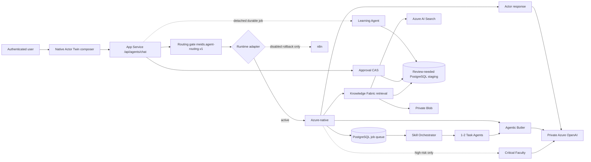
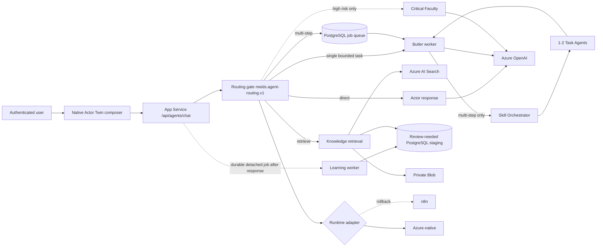

# Me.IDs Azure-native agent target

Last updated: 2026-11-12

## Current production interaction

## Target interaction and adapter boundary

## Decisions

1. `meids.agent-routing.v1`, `meids.agent-work.v1` and `meids.agent-slo.v1` remain provider-neutral contracts. Moving a worker from n8n to Azure must not change them.
2. Actor Twin answers directly when no stored fact, evidence, work artifact or side effect is requested.
3. Personal, organizational, evidence and prior-decision questions retrieve approved knowledge before generation. Missing evidence returns `not_found` plus one targeted question.
4. One bounded, no-side-effect task bypasses Skill Orchestrator. Multi-step work is acknowledged and queued before generative work begins.
5. Critical Faculty runs only for high-risk or uncertain evidence-dependent decisions.
6. Learning is detached from the user response and may create only review-needed proposals.
7. Unknown completion is never retried automatically. Cancellation is allowed only before a worker lease is acquired.
8. The browser receives no n8n worker URL in native mode. Authentication, retrieval, progress, cancellation and result reads go through App Service routes.

## Azure production resources

| Capability | Resource / contract | State |
| --- | --- | --- |
| Runtime API | `meids-prod-backend-1853a19b` | Existing |
| Durable queue | PostgreSQL `runtime.background_job`, migration 020 | Applied |
| Model | `aoai-meids-prod-1853a19b` / `meids-gpt-4-1-mini` | Provisioned, managed-identity RBAC |
| Retrieval | `srch-meids-prod-1853a19b` | Existing |
| Artifacts | `stmeidsprod1853a19b` private Blob | Existing |
| Browser composer | `MEIDS_NATIVE_ACTOR_CHAT=true` | Production; no n8n URL exposed |
| Runtime | `MEIDS_AGENT_RUNTIME=azure_native` | All classified Actor routes and canonical legacy aliases use Azure-native execution |
| Model network | private endpoint and private DNS | Public Azure OpenAI access disabled after live App Service proof |
| Runtime fallback | `MEIDS_AGENT_AZURE_FALLBACK_TO_N8N=false` | Disabled after fallback-off production canaries |
| Rollback assets | n8n settings and workflows | Retained but dormant for the measured rollback/audit window |

## Current rollout state

- PRs #56-#64 moved Actor, Butler, Skill, Task, Critical Faculty, Learning, approvals, voice preparation and legacy aliases behind the Azure-native adapter. The current backend revision is merge commit `1e34aa83713e021e54078dcc00d376c25134ed73`, deployed by run `43267976986`; the native frontend remains active.
- The browser talks only to authenticated App Service routes; direct n8n URLs are empty in production runtime configuration.
- Direct-answer shadow and primary canaries passed from the real App Service web process. A 20-request soak returned 20/20 expected answers with p50 814 ms, p90 1,044 ms and max 1,402 ms.
- Missing and forged knowledge tokens both return `401 blocked_auth_context`.
- Retrieval shadow and primary canaries passed. No matching approved evidence returns `not_found` and one targeted question without speculation.
- App Service managed identity continued to answer after Azure OpenAI public access was disabled, proving the private model path.
- Migration 020 is applied. Async work acknowledged in 163 ms and completed in one attempt through Skill Orchestrator, two Task Agents and Butler synthesis with no fallback.
- Conditional Critical Faculty completed an evidence-dependent production canary in 5,670 ms. Harmless direct and single-task paths did not invoke it.
- Approval resume uses operation binding, expiry and owner/twin checks. PR #66 moved the claim, bounded Knowledge/Skill write and terminal status into one PostgreSQL transaction. Ephemeral PostgreSQL races passed in both directions, action failure restored pending with no effect, and PROD accepted exactly one of two concurrent decisions.
- PR #68 makes the server-held Approval snapshot authoritative. Resume accepts decision and review note only; changed Knowledge, Skill, target, operation or revision fields return `409 approval_operation_binding_mismatch` before the Approval is claimed.
- PR #70 validates crash boundaries with a separate worker and disposable PostgreSQL: termination after the action but before commit rolls back the effect and claim; termination after commit but before acknowledgement leaves one terminal effect and refuses replay.
- PR #72 injects failures at every Knowledge write (`concept`, `source`, revision, chunk, evidence, outbox and audit) and every Skill proposal write (spec and audit). All writes and the Approval claim roll back together to retryable pending; success traces prove one PostgreSQL process and transaction.
- PR #74 observes a real Knowledge lock wait and `55P03` timeout, then forces a two-transaction `40P01` deadlock in disposable PostgreSQL. Aborted decisions return to retryable pending with no partial write or automatic replay; exactly one deadlock contender persists an effect. The artificial cycle validates the error path, not a production lock-order defect.
- PR #76 closes the stale-grant TOCTOU path. Approval execution now re-reads and share-locks the active application user, active twin and current pre-Approval grant inside the same transaction as the bounded action. Deterministic PostgreSQL races prove revoke-wins, action-wins, disabled-user denial and revoke/regrant ABA denial. Backend commit `d7457cf7e5d3177f9da1210c654814bd7d9f827f` is deployed by run `43271669889`.
- PR #78 and migration 021 make the stored Approval operation snapshot immutable in PostgreSQL while retaining bounded lifecycle fields for claim, failure, rejection and completion. A real two-connection race proves that a mutation before claim is rejected and a mutation during execution waits on the claimed row before it is rejected. Migration 021 and its trigger were verified in production; backend commit `7b52c6750e3823f4fd5b42b5b430cb16b4d1e533` is deployed by run `43273528569`.
- PR #80 adds owner/twin-scoped, read-only Approval reconciliation. A fresh `FOR UPDATE NOWAIT` observation confirms terminal completion, reports a locked transaction as unknown in flight and never invokes the bounded action. PostgreSQL tests prove full rollback after a real `57014` statement timeout, pool reuse, no replay during an in-flight commit, repeatable terminal reads after a Reconciler process is killed, and foreign-scope non-disclosure. Backend commit `307fb69d3a6f00e2beba042efcf3ff869fcf4253` is deployed by run `43276075758`.
- PR #82 validates commit uncertainty across the actual PostgreSQL wire boundary. A test-only TCP proxy forwards `COMMIT`, waits for server `ReadyForQuery`, drops the response and closes the connection. The first run exposed and fixed an unhandled `pg` client error event that could terminate the backend during this exact failure. The final PostgreSQL test confirms one effect, terminal reconciliation and no replay. Reconciler death before read, death after read and stale dual-Reconciler ordering are also side-effect free. Backend commit `fa875c086e776423c24224f24afd80733a6b6d45` is deployed by run `43278343906`.
- Signed Entra object IDs are resolved to canonical `identity.app_user` IDs and intersected with current twin grants before Search or persistence.
- Voice handoff is Azure-native, prepare-only and approval-gated. Missing and forged signed tokens return 401.
- Final `azure_native` smoke: direct 1,480 ms, unknown reviewed fact 2,557 ms, bounded work 671 ms, tacit interview 591 ms and clarification 63 ms; no fallback was recorded.

## Cutover gates

- Shadow and fallback-off comparisons show no observed tenant, user, twin, evidence or approval drift for the owner UAT identity.
- Direct and retrieval p90 remain within 20/30 seconds; async acknowledgement remains below 10 seconds. Direct is currently 1.044 seconds p90 across 20 serial requests.
- Native chat passes expired-auth no-replay, queued-only cancellation, keyboard and responsive-browser tests.
- Azure OpenAI access is private-network restricted and remains reachable only through the proven App Service path.
- Route canaries passed in this order: direct, retrieval, synchronous work, background work, conditional critique, approval resume, voice preparation and detached Learning.
- The Nightly harness now targets authenticated App Service routes and correlates fresh Azure-native root traces, provider/model metadata, role executions and an owner-scoped Learning job. Its Learning probe generates a real proposal in `dry_run` mode and proves `not_persisted`; historical n8n execution evidence remains rollback/audit evidence only.
- Production Nightly evidence now passes all five scenarios and all seven Azure-native roles. The signed-token App Service exclusions are limited to the four application-authorized runtime routes and remain fail-closed in the backend.
- Open before physical n8n removal: complete two-principal/guest RLS, run a measured rollback rehearsal, prove zero n8n egress during the observation window, and satisfy audit retention.
- After those gates, remove n8n webhook settings, API credentials, workflow administration UI and retained workflow assets in one separately approved retirement release.
