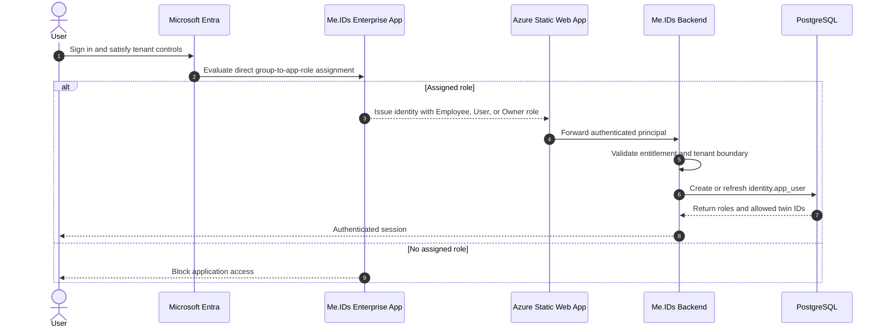

# Me.IDs Authentication and Access Rights

Date: 2026-10-21

## Purpose

This document shows how Microsoft Entra authentication, enterprise application
admission, Me.IDs provisioning, and data authorization work together. The
Actor Twin remains the only user-facing agent, while PostgreSQL remains the
authority for twin and knowledge access.

## End-to-end flow

```mermaid
flowchart LR
  subgraph Identities[Identity sources]
    Employee[Eraneos employee]
    Guest[External collaborator]
    Owner[Me.IDs owner]
  end

  subgraph Entra[Microsoft Entra tenant]
    SignIn[Microsoft sign-in and MFA]
    Workforce[AZ_USC_Eraneos-Standard-Users]
    Invite[B2B invitation accepted]
    Users[Me.IDs Users]
    Owners[Me.IDs Owners]
  end

  subgraph EnterpriseApp[Me.IDs Production enterprise application]
    Required{Assignment required?}
    EmployeeRole[MeIDs.Employee]
    UserRole[MeIDs.User]
    OwnerRole[MeIDs.Owner]
  end

  subgraph Runtime[Azure application boundary]
    SWA[Azure Static Web App custom Entra provider]
    Session[Backend session validation]
    JIT[JIT app-user provisioning]
    Pending[403 access_pending]
  end

  subgraph Data[Me.IDs authorization]
    AppUser[(identity.app_user)]
    TwinAccess[(twin.user_twin_access)]
    RLS[PostgreSQL row-level security]
    Knowledge[Scoped twins and knowledge]
  end

  Employee --> SignIn
  Guest --> Invite --> Users
  Owner --> SignIn
  SignIn --> Workforce
  SignIn --> Owners

  Workforce --> EmployeeRole
  Users --> UserRole
  Owners --> OwnerRole
  EmployeeRole --> Required
  UserRole --> Required
  OwnerRole --> Required

  Required -->|assigned| SWA
  Required -->|not assigned| Pending
  SWA --> Session
  Session -->|valid Employee, User, or Owner role| JIT
  Session -->|no entitlement| Pending
  JIT --> AppUser
  AppUser --> TwinAccess
  TwinAccess --> RLS
  RLS --> Knowledge

  classDef identity fill:#F4F1EA,stroke:#5F5B52,color:#171916;
  classDef entra fill:#E7F3F0,stroke:#2B7A70,color:#171916;
  classDef role fill:#E8EEF7,stroke:#396A9F,color:#171916;
  classDef runtime fill:#FFF1D6,stroke:#B27400,color:#171916;
  classDef data fill:#EEF0EC,stroke:#56634F,color:#171916;
  classDef denied fill:#FBE8E6,stroke:#B6453A,color:#171916;

  class Employee,Guest,Owner identity;
  class SignIn,Workforce,Invite,Users,Owners entra;
  class Required,EmployeeRole,UserRole,OwnerRole role;
  class SWA,Session,JIT runtime;
  class AppUser,TwinAccess,RLS,Knowledge data;
  class Pending denied;
```

## Authorization sequence

## Roles and rights

| Entra app role | Source group | Default Me.IDs role | Intended access |
|---|---|---|---|
| `MeIDs.Employee` | `AZ_USC_Eraneos-Standard-Users` | `viewer` | Potential internal user. Creates and accesses only owned or explicitly shared twins. |
| `MeIDs.User` | `Me.IDs Users` | `viewer` | Approved B2B guest or manually approved exception. |
| `MeIDs.Owner` | `Me.IDs Owners` | `owner` | Application administration and governed approvals. It does not bypass tenant or data isolation. |

## Guest access lifecycle

```mermaid
flowchart LR
  Sponsor[Internal sponsor] --> Invite[Invite external identity through Entra B2B]
  Invite --> Accept[Guest accepts invitation]
  Accept --> Add[Add guest directly to Me.IDs Users]
  Add --> Role[Assign MeIDs.User through the enterprise app]
  Role --> FirstLogin[First Me.IDs login]
  FirstLogin --> Provision[JIT provision app_user]
  Provision --> Twin[Guest creates or receives explicit twin access]
  Twin --> Review[Quarterly access review]
  Review -->|still required| Twin
  Review -->|no longer required| Remove[Remove group membership and application access]

  classDef action fill:#E7F3F0,stroke:#2B7A70,color:#171916;
  classDef review fill:#FFF1D6,stroke:#B27400,color:#171916;
  classDef remove fill:#FBE8E6,stroke:#B6453A,color:#171916;
  class Sponsor,Invite,Accept,Add,Role,FirstLogin,Provision,Twin action;
  class Review review;
  class Remove remove;
```

## Control principles

- Direct enterprise-app assignments are used because nested group membership is
  not expanded for application assignment.
- Authentication confirms identity. App roles determine admission. PostgreSQL
  determines access to twins and knowledge.
- The employee role is accepted for JIT provisioning only for identities whose
  resolved address ends in `@eraneos.com`.
- New users receive no fallback twin. They create a twin or receive an explicit
  `twin.user_twin_access` mapping.
- Guests require an accepted B2B object and direct `Me.IDs Users` membership.
- Owners cannot bypass tenant boundaries, row-level security, or knowledge
  visibility rules.

## Current activation dependency

The runtime and automation are prepared. An Entra administrator still needs to
create or authorize the `Me.IDs Production` application registration, app roles,
and direct group assignments. The custom Static Web App identity provider must
only be activated after `AZURE_CLIENT_ID` and `AZURE_CLIENT_SECRET` exist.
