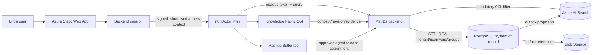

# Zielmodus: Production Data and User Knowledge Access

Status: implemented and Azure what-if validated on 2026-10-05; live PostgreSQL
provisioning is held at the documented production gate.

## Goal

Make PostgreSQL the authorization and knowledge-system-of-record, Blob Storage
the immutable artifact store, and Azure AI Search a disposable retrieval
projection. Keep Actor Twin as the only user-facing agent and preserve n8n as
the orchestration layer.

## Decisions

1. Microsoft Entra object IDs map to internal users in PostgreSQL.
2. Users receive explicit assignments to one or more twins. The active twin is
   a conversation scope, not the authorization source.
3. Concepts and learning increments always carry tenant, owner, and twin IDs.
4. Agent releases are immutable and assigned by tenant, group, user, or twin.
   Agent configuration never contains user knowledge.
5. Azure AI Search uses the same tenant/user/twin ACL projection as PostgreSQL.
   Retrieval always applies a server-generated filter; callers cannot replace
   it with an arbitrary OData filter.
6. The browser receives a short-lived signed knowledge-access token from the
   authenticated backend. n8n passes it as an opaque credential to backend
   tools. It must never be inserted into an LLM prompt or execution log.

## Runtime Relationships



## Knowledge Mapping

### A. User-identical knowledge

Private knowledge is readable when `owner_user_id` equals the authenticated
user. The concept, revisions, chunks, evidence, Search document, and source all
retain that same owner ID. A user cannot select another owner in a request.

Default query scope is `active_twin`. This limits results to the active twin,
even when the user is assigned to several twins.

### B. User-overarching knowledge

Cross-user knowledge is readable only through one of these persisted grants:

- assignment to the knowledge's twin with `twin_shared` visibility;
- explicit user grant;
- membership in an allowed group for `team_shared` knowledge;
- tenant membership for reviewed `org_shared` knowledge.

An `all_assigned_twins` query may search all twins listed in the signed token,
but cannot name an unassigned twin. This supports synthesis across authorized
knowledge without making another user's private concepts visible.

## Same Vector Database

A shared Search service and index are acceptable when every indexed document
contains `organization_id`, `owner_user_id`, `twin_id`, `allowed_user_ids`,
`allowed_group_ids`, `visibility_scope`, and `acl_version`. The backend builds
the security filter from verified claims and ANDs it with review-state rules.

Do not expose Azure AI Search directly to the browser or to a free-form agent
tool. Managed identity authorizes the backend to Search; the application-level
ACL filter authorizes the user to documents.

## n8n Contract

The embedded chat metadata carries `authorization.knowledgeAccessToken` and
`authorization.knowledgeScope`. Actor Twin and subagents treat the token as an
opaque value. An HTTP Request or Call Workflow node passes it to the backend as:

```text
Authorization: Bearer {{$json.metadata.authorization.knowledgeAccessToken}}
```

For a normal question use `active_twin`. For an explicit request to synthesize
knowledge across the user's twins, send `knowledge_scope=all_assigned_twins`.
The backend still constrains the query to token-authorized twin IDs.

Because n8n receives the token as workflow input, production execution-data
retention must be minimized: disable successful execution payload storage for
these workflows, keep error retention short, enable pruning, and restrict n8n
execution-log access. The token expires after five minutes and the frontend
refreshes the embedded chat context before expiry. The token contains identity
and grant claims, never knowledge content or repository credentials.

## Implemented Files

- `backend/knowledgeAccess.js`: signed access context and Search filter.
- `backend/migrations/001_production_data_model.sql`: production schemas, ACLs,
  row-level security, agent assignments, learning records, and outbox.
- `backend/azureSearch.js`: ACL projection and mandatory security filter.
- `frontend/app.js`: authenticated access context in n8n metadata.
- `infra/azure/production-data-plane.bicep`: private PostgreSQL and VNet package.
- `scripts/run-postgres-migrations.cjs`: immutable migration runner.

## Deployment Gate

The following inputs require a tenant decision before live provisioning:

1. Entra PostgreSQL administrator group: completed. The dedicated group is
   `Me.IDs Production PostgreSQL Administrators`
   (`a85b18b9-428a-4169-91e9-c7b1cc0d159e`).
2. Approval of `10.42.0.0/16` or an alternative non-overlapping address range.
3. Zone-redundant HA and geo-redundant backup cost decisions.
4. Creation of Key Vault secret `meids-auth-context-signing-key` with at least
   32 random bytes.
5. A maintenance window to migrate PostgreSQL and rebuild both Search indexes.

Azure discovery initially found no existing Me.IDs or Intellectual Twin Entra
group. The dedicated production database-admin group was created on 2026-10-06
and the signed-in user was verified as both owner and member. The earlier
what-if used the signed-in user only as a non-deploying validation placeholder;
the production parameter file now uses the group.

## Activation Order

1. Deploy `production-data-plane.bicep` after the gate is approved.
2. Create the database service principal/user mappings and run `npm run db:migrate`.
3. Populate tenant, users, groups, twins, and twin assignments.
4. Add the signing secret and enable `MEIDS_ENFORCE_KNOWLEDGE_AUTH=true`.
5. Update Azure AI Search index contracts and rebuild the approved and working indexes.
6. Update n8n retrieval, duplicate-check, and vector-upsert nodes to forward the opaque token.
7. Run isolation UAT with two users, two twins, one shared group, and private/team/org concepts.
8. Enable production traffic only after both positive and negative access tests pass.

For the system-assigned App Service identity, an Entra PostgreSQL administrator
must run the following once in `meids_prod` (replace the principal name with the
backend App Service managed-identity display name):

```sql
SELECT * FROM pgaadauth_create_principal('meids-prod-backend-1853a19b', false, false);
GRANT meids_app_runtime TO "meids-prod-backend-1853a19b";
```

Configure the backend with `POSTGRES_AUTH_MODE=managed_identity`,
`DATABASE_HOST=<server>.postgres.database.azure.com`,
`DATABASE_NAME=meids_prod`, `DATABASE_USER=meids-prod-backend-1853a19b`,
`DATABASE_SSL=true`, `MEIDS_STORAGE_MODE=postgres`, and finally
`MEIDS_AUTHZ_DATABASE_ENABLED=true`. No database password belongs in Key Vault.

## Acceptance Tests

- User A sees private chunks owned by User A and never User B's private chunks.
- User A can search all assigned twins only when requesting overarching scope.
- A team member sees reviewed team knowledge after group assignment.
- Removing a grant removes retrieval on the next request and projection refresh.
- Pending concepts appear only in authorized review flows.
- Arbitrary caller-supplied Search filters cannot bypass the server filter.
- Agent configuration resolves for tenant/group/user/twin without embedding
  knowledge or secrets in prompts.
