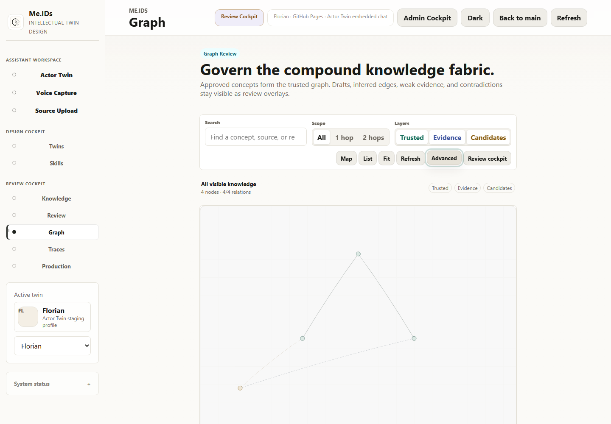
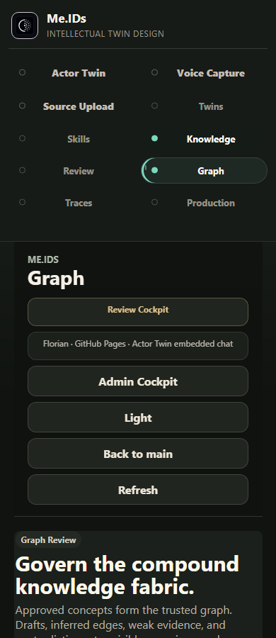

# Graph Explorer V2 Preview Evidence

Date: 2026-10-29
Branch: `feature/graph-explorer-v2`
Release posture: preview only; production remains unchanged

## Objective

Refine the Me.IDs Knowledge Graph into a lean, Obsidian-inspired explorer while preserving production APIs, data, authorization, n8n workflows, graph semantics, review states, persistence, and every existing graph action.

## Safety boundary

- `graphExplorerV2` defaults to `false` in the checked-in runtime configuration.
- The build flag is explicit: `MEIDS_GRAPH_UI_V2=true`.
- The production `main` deployment does not set this flag.
- The V2 flag is set only by the Azure Static Web App pull-request preview job.
- No backend, database, Search, vector, n8n, Entra, or graph persistence contract was changed.
- The legacy graph remains present in the DOM and is available through one `Advanced` interaction.
- Rollback is flag-only: remove or disable `MEIDS_GRAPH_UI_V2` and rebuild.

## Implemented experience

1. Full-width explorer canvas with search, `All / 1 hop / 2 hops`, knowledge layers, Map/List, fit, refresh, and Review Cockpit access.
2. Trusted and Evidence layers enabled by default; Candidates are opt-in.
3. Hover and keyboard focus emphasize a node, direct neighbors, and connecting edges while dimming unrelated graph content.
4. Delayed node and edge tooltips expose type, state, relation count, evidence count, confidence, and "Why connected?" context.
5. Click or `Enter` locks selection and opens one detail drawer; `Escape` clears it.
6. Advanced governance, recommendations, projection controls, exports, and AI tools remain available behind `Advanced` or Review Cockpit.
7. SVG nodes have keyboard focus, visible focus treatment, and an invisible enlarged hit target.
8. Reduced-motion mode removes graph transitions and smooth scrolling.
9. Minimap rendering is suppressed below 80 visible nodes.
10. Iteration 2 reduces nodes to degree-scaled dots, thins relation lines, quiets labels at rest, and introduces neutral layer-specific visual treatment. See `graph-explorer-v2-iteration-2-20261029.md`.

## Decisions

| Decision | Reasoning | Consequence |
| --- | --- | --- |
| Recompose existing DOM instead of creating a new graph engine. | Current rendering already preserves graph semantics, review actions, and persistence contracts. | No API or data migration is required. |
| Preserve every legacy governance surface behind `Advanced`. | Graph exploration should be calm by default without removing operator capability. | Existing actions remain within one extra interaction. |
| Keep SVG for this preview and benchmark before Canvas/WebGL. | SVG retains accessibility and is adequate until evidence shows otherwise. | Canvas/WebGL remains a later decision for sustained graphs above the measured range. |
| Use stable existing topology positions for depth and layer filtering. | Local exploration must not move nodes unexpectedly. | `All`, `1 hop`, and `2 hops` filter the existing projection without force-animation restarts. |
| Deploy only through the pull-request preview workflow. | The production launch posture must remain untouched during UI refinement. | Owner UAT can occur on an isolated Azure URL before any promotion decision. |

## Verification

Automated checks:

- `npm run check:graph-explorer`
- Static build with `MEIDS_GRAPH_UI_V2=true`
- Five Graph Explorer browser cases: 1440 light/dark, 1024 light, and 390 light/dark
- Keyboard selection, `Escape`, Map/List parity, advanced disclosure, layer toggles, local depth, tooltip, focus, overflow, and reduced-motion checks
- Existing dark-mode regression suite: six cases, including graph relation review and promotion actions
- Synthetic hover benchmark at 100, 500, and 1,000 rendered node elements

Acceptance status:

| Gate | Result |
| --- | --- |
| Production deployment | Not performed |
| Network request or payload change | None |
| Existing graph governance actions | Passed through `Advanced` regression path |
| Feature default | Disabled |
| 500-node hover budget | Passed; 2.7 ms p95 |
| Desktop/tablet/mobile overflow | Passed |
| Keyboard and focus behavior | Passed |
| Reduced motion | Passed |
| Immediate rollback | Passed by default-disabled runtime flag |

Machine-readable evidence: `docs/visual-qa/screenshots-20261029-graph-explorer-v2/graph-explorer-v2-qa.json`.

## Before And After

Baseline, with the complete governance cockpit expanded on the Graph page:

Graph Explorer V2 desktop preview:

Graph Explorer V2 mobile dark preview:

## Promotion Gate

Do not promote this branch to `main` until owner UAT confirms:

1. Trusted/Evidence default layers match the intended production reading policy.
2. Candidate visibility and Review Cockpit handoff are understandable without training text.
3. A representative production-sized graph keeps selection, labels, and local-depth transitions stable.
4. Screen-reader list navigation is accepted with the production authentication boundary enabled.
